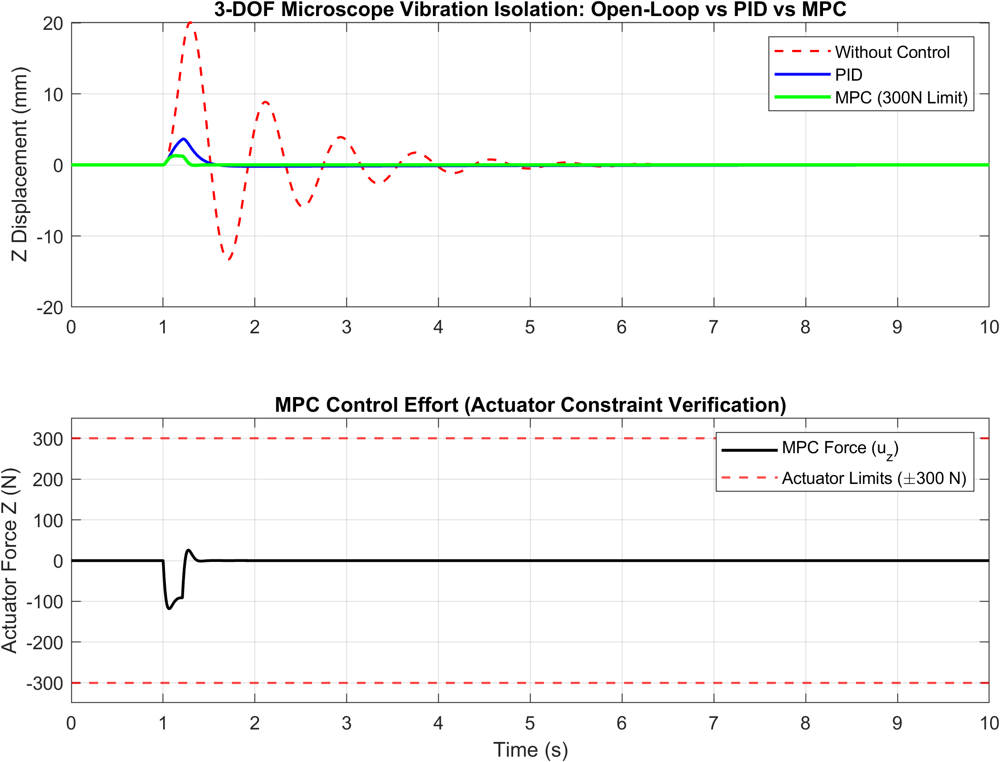

# 3-DOF Active Vibration Isolation for an Electron Microscope using MPC

This repository presents the modeling, control design, and performance comparison of an active vibration isolation system for a high-precision electron microscope table. A custom **Model Predictive Controller (MPC)** is formulated from scratch using Quadratic Programming (`quadprog`) to handle actuator saturation constraints and is benchmarked against a baseline **PID** controller and the uncontrolled (Open-Loop) system.

## System Overview
* **Model:** 3-DOF Mass-Spring-Damper system (6 states: position and velocity along $X, Y, Z$ axes).
* **Disturbance:** 100 N external impulse applied at $t = 1\text{ s}$ for $0.2\text{ s}$.
* **Actuator Constraint:** $\pm 300\text{ N}$ maximum force per axis.
* **Control Formulation:** Custom discrete-time MPC ($T_s = 0.01\text{ s}$, Prediction Horizon $p = 20$) solved via `quadprog` (Optimization Toolbox) without relying on the built-in MPC Toolbox.

## Performance Results (Z-Axis)

| Control Strategy | Peak Displacement | Vibration Reduction | Max Control Force |
| :--- | :---: | :---: | :---: |
| **Open-Loop (No Control)** | 20.07 mm | — | 0 N |
| **PID Controller** | 3.66 mm | 81.8% | Unconstrained |
| **Custom MPC (`quadprog`)** | **1.29 mm** | **93.6%** | **118.0 N** (Limit: 300 N) |

## Repository Structure
1. `System_Modeling_3DOF.m` — Derives the continuous and discrete state-space matrices ($A, B, C, D$) of the 3-DOF isolation table.
2. `PID_Baseline_Control.m` — Simulates the open-loop disturbance response and designs a 3-axis decentralized PID baseline.
3. `MPC_Controller_Design.m` — Constructs prediction matrices ($F, G$), cost matrices ($H, f$), and runs the receding-horizon optimization loop via `quadprog`.
4. `Compare_Results.m` — Computes performance metrics and generates the displacement and control effort comparison plots.

## How to Run
Run the scripts in MATLAB in the following order:
1. `System_Modeling_3DOF.m`
2. `PID_Baseline_Control.m`
3. `MPC_Controller_Design.m`
4. `Compare_Results.m`

**Requirements:** MATLAB, Control System Toolbox, Optimization Toolbox (`quadprog`).
